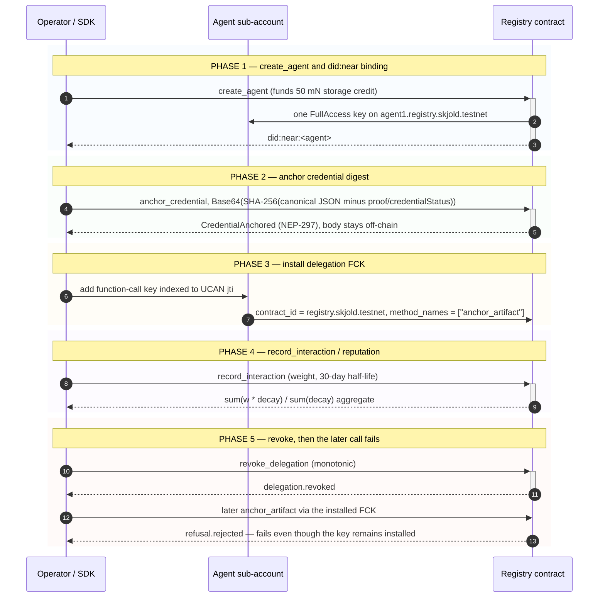

# skjold

Tracks: `security`, `agents` · License: Apache License 2.0 · Baseline `pre-hackathon` @ `28b5b21`, diff `git diff pre-hackathon..hackathon-submission` · Q-015 (second project on this email): **stele** (tracks `nfts`, `realworld`).

Agent identity without shared keys: each agent is a NEAR sub-account whose DID resolves to one owner key. The registry anchors credential digests, delegations, reputation and TEE attestations, and revocation stops future calls even if the key remains installed.



```bash
export SKJOLD_REGISTRY_ID=registry.skjold.testnet
export SKJOLD_OPERATOR_ACCOUNT=registry.skjold.testnet
export SKJOLD_OPERATOR_KEY=ed25519:...
export SKJOLD_VC_ISSUER_ACCOUNT=vc-issuer.registry.skjold.testnet
export SKJOLD_VC_ISSUER_KEY=ed25519:...
export NEAR_RPC_URL=https://rpc.testnet.near.org
echo '{"issuer":"did:near:vc-issuer.registry.sandbox","credentialSubject":{"id":"did:near:agent1.registry.skjold.testnet","name":"agent1"}}' | node sdk/scripts/recompute-vc-digest.mjs
(cd contracts/registry && cargo test --test test_basics registry_flow_end_to_end -- --nocapture 2>&1 | grep MEASURED_ANCHOR_CREDENTIAL_TGAS)
```

| Do this | See this | Proves |
|---|---|---|
| `rustup target add wasm32-unknown-unknown` ; `cargo install cargo-near --version 0.23.0` | wasm target + toolchain ready | Rust `1.100+`, `wasm32-unknown-unknown` |
| `(cd sdk && pnpm install --prod)` ; `bash scripts/check-contract.sh` | registry wasm compiles | `skjold-registry 0.1.0`, near-sdk `5.30.2` |
| `(cd contracts/registry && cargo test --test test_demo -- --nocapture)` | `1 passed; 0 failed`, zero-funds demo | `47810000000000000000000` yocto (47.81 mN) credit |
| `node sdk/scripts/recompute-vc-digest.mjs` | `{"digest":"Gd3XyeMIntCJYtk4xeqMXC6lw7x0HVEFNmE7T0ftVxs=","canonical_bytes":133}` | credential digest anchored → off-chain credential flow works |
| `cargo test --test test_basics` | `MEASURED_ANCHOR_CREDENTIAL_TGAS=3.195` | `3.195 TGas` per `anchor_credential` |
| `cargo test` | contract + sandbox tests pass | registry behavior tested (NEP-297, `skjold-registry` `1.0.0`) |
| `node sdk/src/demo.js` | 9-step JSON summary, exit 0 | testnet demo; testnet faucet funds only |
| `git rev-parse --short hackathon-submission` ; `git diff pre-hackathon..hackathon-submission` | baseline `pre-hackathon` @ `28b5b21` | attestix 0.5.0 port, Apache License 2.0 |
| `## Limits and security notes` | No third-party audit; raw `Digest32` JSON wire; no NEP-366 meta-transactions (`signer_account_pk()`) | FCK scoped to `registry.anchor_artifact` (`method_names = ["anchor_artifact"]`); cannot move NEAR or add keys; revocation is monotonic |

[ATTRIBUTION.md](ATTRIBUTION.md) · [attestix 0.5.0 by VibeTensor](https://github.com/VibeTensor/attestix) · [LICENSE](LICENSE) · [NOTICE](NOTICE) — Apache License 2.0.
