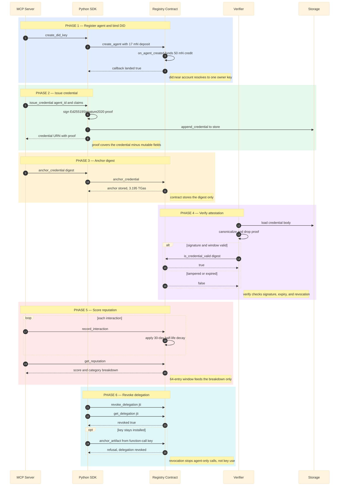

# skjold
**Agent identity and KYA (Know Your Agent) on NEAR.** The primitive uses **function-call access keys + did:near registry**. It has one contract (`registry.skjold.testnet`), a Python MCP/REST/CLI surface, and a Node SDK.

Each agent is a sub-account such as `agent1.registry.skjold.testnet` and holds one FullAccess key. `did:near:agent1.registry.skjold.testnet` resolves to one `#owner` verification method. The registry stores the agent record and the canonical UAIT digest. It also stores credential anchors, delegation records, the reputation aggregate, TEE bindings, and artifact anchors. Credentials are signed off-chain. The registry anchors only the digest. A delegation is a function-call access key on the agent account with `contract_id = registry.skjold.testnet` and `method_names = ["anchor_artifact"]`. The registry indexes that key to the UCAN `jti`. Revocation stops future calls, even if the key remains installed.



## Quickstart
### Prerequisites
| Requirement | Version / note |
|---|---|
| Rust | 1.100 or newer (contract `rust-version = 1.100`) |
| Rust target | `wasm32-unknown-unknown` |
| cargo-near | 0.23.0 for deployment builds. The test harness uses `cargo-near-build 0.11.5` |
| Node | 26.13.1 or newer (`sdk/package.json` engines) |
| pnpm | 12.18.0 or newer |
| Python | 3.12 or newer (`pyproject.toml` `requires-python`) |
| near-sandbox | 0.4.1. Sandbox tests need Linux x86_64. near-sandbox also ships a macOS ARM64 binary. |

```bash
rustup target add wasm32-unknown-unknown
cargo install cargo-near --version 0.23.0
```

### 1. Install the Node dependencies
```bash
(cd sdk && pnpm install --prod)
```
`sdk/node_modules/near-api-js` is at 7.5.3.

### 2. Check the contract for the wasm target
```bash
bash scripts/check-contract.sh
```
The script enters `contracts/registry` and runs `cargo check --target wasm32-unknown-unknown`. It exits 0 on success.

### 3. Run the zero-funds sandbox dry run
```bash
(cd contracts/registry && cargo test --test test_demo -- --nocapture)
```
The test starts a local `near-sandbox` and creates `registry.sandbox`, `operator.sandbox`, and `vc-issuer.registry.sandbox`. It builds and deploys the registry, then runs `node sdk/src/demo.js` against the sandbox RPC. The output holds one `DEMO_TRANSCRIPT=` line and this summary:

```text
test node_demo_zero_funds ... ok
test result: ok. 1 passed; 0 failed
```
- `steps` has 9 entries, in order. The first three cover config and canonical UAIT digest, `create_agent` and `on_agent_created`, and VC issue with `skjold-vc-digest/v1` cid anchor.
- Entries four to six are `record_delegation`, FCK install, and FCK anchor_artifact. Entry seven covers two interactions with reputation, credential, and `did:near` checks.
- Entries eight and nine are `revoke_delegation` and the refused FCK call with `get_delegation(jti).revoked`.
- `identity.callback_landed` is `true`, `credential.valid_on_chain` is `true`, `delegation.revoked` is `true`, and `refusal.rejected` is `true`.
- `identity.storage_credit_yocto` is `47810000000000000000000` (47.81 mN remaining from 50 mN). `refusal.error` contains `delegation revoked`.
- `did_document.verification_method` is `did:near:<agent>#owner`. `did_document.public_key_base58` is the agent FullAccess Ed25519 key.

Stdout prints the same `DEMO_TRANSCRIPT=` JSON. `evidence/DEMO-TRANSCRIPT.json` holds the reference capture. The test fails if any check fails. The sandbox tests are compiled only on Linux. Both `tests/test_basics.rs` and `tests/test_demo.rs` begin with `#![cfg(target_os = "linux")]`. On another host, `cargo test` reports zero tests for those files. Use a Linux machine or Linux guest.

### 4. Run against testnet or a local node
The demo does not deploy the registry or create the issuer account. Point the demo at a registry initialized with `new(operator)`. The issuer account must already exist with one FullAccess key. Run from the repository root, after `pnpm install --prod` in `sdk`:
```bash
export SKJOLD_REGISTRY_ID=registry.skjold.testnet
export SKJOLD_OPERATOR_ACCOUNT=registry.skjold.testnet
export SKJOLD_OPERATOR_KEY=ed25519:...   # replace with the operator secret key
export SKJOLD_VC_ISSUER_ACCOUNT=vc-issuer.registry.skjold.testnet
export SKJOLD_VC_ISSUER_KEY=ed25519:...  # replace with the issuer secret key
export NEAR_RPC_URL=https://rpc.testnet.near.org
node sdk/src/demo.js
```
`SKJOLD_OPERATOR_ACCOUNT` defaults to `SKJOLD_REGISTRY_ID`, and `SKJOLD_VC_ISSUER_ACCOUNT` defaults to `vc-issuer.<SKJOLD_REGISTRY_ID>`. Set `NEAR_RPC_URL` for a local node. `NEAR_NETWORK` labels the run and defaults to `testnet`. Stderr prints step logs. Stdout prints one JSON summary with the 9 steps and verification fields. The process exits 0 only when all checks pass. The sandbox test above is the automated path. This command targets your deployed registry. Use testnet faucet funds only. This repository has no real-funds flow and no mainnet deployment. Do not target mainnet.

## Measured cost
**`3.195 TGas` per `anchor_credential`**, measured as the total gas burnt across the transaction and all receipts. `contracts/registry/tests/test_basics.rs` reads `TransactionResult::Full(r).total_gas_burnt` and prints TGas with three decimals. Two fresh runs on the Celesto box `cmp_512755789ee1` returned `3.195`. Raw logs are `evidence/w4-gas.log` and `evidence/w4-gas2.log`. `NUMBERS.md` records the full environment.

```bash
(cd contracts/registry && cargo test --test test_basics registry_flow_end_to_end -- --nocapture 2>&1 | grep MEASURED_ANCHOR_CREDENTIAL_TGAS)
```
The marker line uses the format `MEASURED_ANCHOR_CREDENTIAL_TGAS=3.195`. The test starts a sandbox, builds and deploys the contract, and exercises the full lifecycle. This is a cost metric, not gas income. NEAR protocol version 87 and later (PV≥87) removes the 30% contract gas reward for `anchor_credential`.

## Storage credit
`create_agent` funds 50 mN of prepaid anchor storage per agent in the registry `storage_credit` ledger. The grant is funded once per agent. A function-call access key cannot attach a deposit (`InvalidAccessKeyError::DepositWithFunctionCall`). A zero-deposit `anchor_artifact` call therefore debits the agent credit.

| Call path | Attached deposit | Credit effect |
|---|---|---|
| `create_agent` | 17 mN (10 mN sub-account stake + 7 mN `CreateAccount`) + record storage + 50 mN credit + credit storage. Excess is refunded | `on_agent_created` funds 50 mN |
| `register_existing_agent` (repair) | agent-record storage + 50 mN credit + credit storage. Excess is refunded | funds 50 mN once. A repeat call is a no-op that refunds the deposit |
| `anchor_artifact` from a delegated FCK | 0 | debits the record storage cost |
| `anchor_artifact` from the agent FullAccess key with a deposit | the record storage cost. Excess is refunded | untouched |
| Replay of an identical anchor | any attached deposit is refunded | untouched |

If the credit is smaller than the record cost, the call fails with `insufficient storage credit` and leaves credit untouched. An exhausted credit blocks zero-deposit FCK anchors. Deposited FullAccess calls still work. The 50 mN grant has no top-up method in this revision. The demo starts at 50 mN. After the first FCK anchor it leaves `47810000000000000000000` yocto (47.81 mN). The sandbox suite tests debit, replay, deposited calls, and oversized-record refusal.

## Architecture and layout
The Python layer reads contract views over JSON-RPC. It submits writes through `sdk/src/tx.mjs`. The Node SDK uses near-api-js 7.5.3. Signed VC and UAIT bodies stay in the local body store. The contract stores digests and records.

```text
contracts/registry/
  Cargo.toml                         skjold-registry 0.1.0, near-sdk 5.30.2
  src/{lib,types,identity,credentials,delegation,reputation,tee,anchor,events}.rs
  tests/{test_units,test_basics,test_demo}.rs
sdk/
  src/demo.js                        zero-funds 9-step demo
  src/canonical.mjs                  canonical JSON, UAIT/VC digests, wire helpers
  src/keys.js                        FCK method scope, allowance, add/delete
  src/tx.mjs                         signed transaction transport for Python
  src/did-near.mjs                   did:near resolver and CLI
  scripts/recompute-vc-digest.mjs    digest recomputation
spec/verify/v1/                      7 cross-language conformance vectors
scripts/check-contract.sh            wasm32 type check
tests/                               Python unit and repository/signer contract tests
pyproject.toml                       Python package, `skjold` console script
main.py                              MCP server (47 tools)
api/                                 FastAPI routers
cli.py                               `skjold` CLI
storage/near_repository.py           hybrid chain + body Repository adapter
signing/near_signer.py               NEAR key/digest helpers and NodeTxSigner
services/                            identity, credential, delegation, reputation, DID, blockchain, compliance, provenance
tools/                               MCP tool modules (47 tools across 9 modules)
```

### Contract modules and entry points
| Module | Responsibility | Entry points |
|---|---|---|
| `lib.rs` | state, initialization, storage accounting | `new(operator)` |
| `identity.rs` | agent sub-accounts and did:near binding | `create_agent`, `on_agent_created` (private callback), `register_existing_agent`, `revoke_identity`, `get_identity`, `list_identities` |
| `credentials.rs` | credential digest anchors | `anchor_credential`, `revoke_credential`, `is_credential_valid`, `get_credential_anchor`, `list_credentials` |
| `delegation.rs` | UCAN records and FCK enforcement | `record_delegation`, `revoke_delegation`, `get_delegation`, `list_delegations` |
| `reputation.rs` | decayed trust aggregates | `record_interaction`, `get_reputation`, `query_reputation` |
| `tee.rs` | verified TEE report bindings | `bind_tee_attestation`, `get_tee_attestation` |
| `anchor.rs` | typed artifact anchors and credit | `anchor_artifact`, `get_anchor`, `get_anchor_status`, `estimate_anchor_cost`, `get_storage_credit` |
| `events.rs` | NEP-297 events | 9 variants under the `skjold-registry` standard, version `1.0.0` |
| `types.rs` | records, enums, event payloads | `Digest32 = [u8; 32]` and the serialized record types |

State collections use unique prefixes, for example `agents`, `creds`, `delegations`, `delegation_by_key`, `interactions`, `reputation`, `interaction_ids`, `tee`, `tee_nonces`, `anchors`, and `storage_credit`. Revocation is monotonic for identities, credentials, and delegations. Delegation checks accept the agent FullAccess key or a live, unexpired, unrevoked FCK bound to that agent. A NEP-366 meta-transaction puts the relayer key in `signer_account_pk()`. Agent-only calls must never be relayed. Reputation uses `sum(w * decay) / sum(decay)` with a 30-day half-life. The weights are `success = 1.0`, `partial = 0.5`, `failure = 0.0`, `timeout = 0.2`. The 64-entry window feeds only the category breakdown. Off-chain verifiers check TEE quotes. The contract stores the report digest, signature kind, optional model/image digest, nonce, and previous digest. A gateway signature cannot claim a model. `AnchorRecord` stores the type (`Identity`, `Credential`, `Declaration`, `AuditBatch`), subject, caller, block height, and timestamp. Contracts cannot see the transaction hash, so the client reads it from RPC.

### Python surface and retained MCP tools
The MCP server keeps **47 tools across 9 modules**. The split is Identity 8, Agent Cards 3, DID 3, and Delegation 4. Reputation has 3, Compliance 7, Credentials 8, Provenance 5, and Blockchain 6.

- `create_did_web` is a deprecated stub. It returns a `did:near:<registry>` redirect and an error. It never produces a hosting URL.
- `create_did_key` replaces ephemeral `did:key` keys with a generated Ed25519 keypair. It registers a `<prefix>.<registry>` sub-account via `create_agent` and returns a one-time secret key. It requires `SKJOLD_REGISTRY_ID`.
- `resolve_did` resolves `did:key` locally and resolves `did:near` through `sdk/src/did-near.mjs` for NEAR accounts. Other DID methods are unsupported.
- The six anchor tools (`anchor_identity`, `anchor_credential`, `anchor_audit_batch`, `verify_anchor`, `get_anchor_status`, `estimate_anchor_cost`) manage `AnchorRecord`s. Re-anchors return the existing record, and the client captures the transaction hash.

`NearRepository` maps `identities`, `credentials`, `delegations`, `reputation`, and `anchors` to the contract. It keeps `compliance`, `provenance`, `audit`, `idempotency`, and signed bodies locally. Only tenant `default` is accepted. Other tenants raise an error. Without `SKJOLD_OPERATOR_KEY`, writes raise instead of faking success. `NodeTxSigner` writes one JSON request to `sdk/src/tx.mjs` on stdin and reads one JSON response. Secrets never appear in command arguments. `create_agent` and `did:near` stay synchronized through the registry adapter.

## Limits and security notes
- **No third-party audit.** External firms have not audited the contract or adapters.
- **Single tenant.** `default` is the only accepted tenant in the Python adapter.
- **Revocation is a registry cut-off, not account seizure.** Revoking an identity blocks agent-only registry calls without seizing keys. Deleting the delegation FCK is optional hygiene.
- **Issuer key invariant.** The issuer account must hold one FullAccess key. The demo checks the on-chain keys before signing. A second FullAccess key breaks `#owner` uniqueness.
- **FCK allowance is gas-only and immutable.** The allowance budgets gas only and cannot change in place. Re-issue the key to change the allowance. Treat `revoke_delegation` as authoritative.
- **Credential cid is a project profile.** `skjold-vc-digest/v1` is Base64(SHA-256 of the canonical credential minus `proof` and `credentialStatus`). It differs from the stock did:near ProofType cid.
- **Storage credit is finite.** The 50 mN grant has no top-up method. Exhausted credit blocks zero-deposit FCK anchors. Deposited FullAccess calls still work.
- **Contract JSON wire is raw for digests.** Contract `Digest32` is a 32-element JSON array (`[u8; 32]`). The Node demo uses `toWireDigest`. The Python adapter sends Base64 strings and remains unverified against a live registry.
- **Sandbox tests are Linux-only.** `contracts/registry/tests/test_basics.rs` and `contracts/registry/tests/test_demo.rs` use `#![cfg(target_os = "linux")]`. near-sandbox 0.4.1 ships Linux x86_64 and macOS ARM64 binaries. These tests run on Linux only.
- **No mainnet.** There is no mainnet deployment or claim in this repository. Use testnet or a local sandbox only.
- **Meta-transactions are not supported for agent-only calls.** A relayed NEP-366 call fails the `signer_account_pk()` check by design.

This project provides identity and KYA infrastructure, not a spend firewall or payments engine.

## Origin & baseline
skjold is derived from **attestix 0.5.0** by **VibeTensor** (VIBETENSOR PRIVATE LIMITED) at commit `dcf823e` on `main` (2026-10-30). `LICENSE` keeps the Apache License 2.0. `NOTICE` and `ATTRIBUTION.md` document the origin. The Python package keeps the `attestix` module path and the `skjold` distribution name.

This port keeps:

- The Python MCP / FastAPI / CLI service surface and its `Repository` / `Signer` seams.
- The Ed25519 canonical-JSON credential profile, the UAIT digest rules and the UCAN delegation evidence and verification logic.
- The conformance vectors in `spec/verify/v1/`, unchanged.
- The Python dependency set declared in `pyproject.toml`.

The port replaces EAS/Base anchoring with registry state and NEP-297 events. Setting `SKJOLD_REGISTRY_ID` switches the default adapter to hybrid chain and local-body storage. Origin: https://github.com/VibeTensor/attestix

## Status
- `contracts/registry/tests/test_units.rs`: host unit tests with mocked chain context covering state, authority guards, events, and views.
- `contracts/registry/tests/test_basics.rs`: Linux near-sandbox flow testing identity, credential, delegation, reputation, revocation, storage credit, and the `3.195 TGas` marker.
- `contracts/registry/tests/test_demo.rs`: runs `node sdk/src/demo.js` against near-sandbox and verifies all 9 steps, callback, VC validity, credit debit, revocation refusal, and `#owner` resolution.
- No testnet or mainnet deployment is included. Use a registry you deployed and initialized. No third-party security audit exists.
- The Python live chain-write path is not verified against a deployed registry due to the wire mismatch under Limits.
- Submission and demo video are human actions, not repository outputs.
- This repository claims no prize. Neither this port nor upstream attestix was a hackathon winner.
- This is identity and KYA infrastructure only, not a spend firewall.

## License
Apache License 2.0. See `LICENSE`, `NOTICE` and `ATTRIBUTION.md`.
Tracks: `security`, `agents`. Development ends 2026-11-14T23:59:00Z (UTC).
